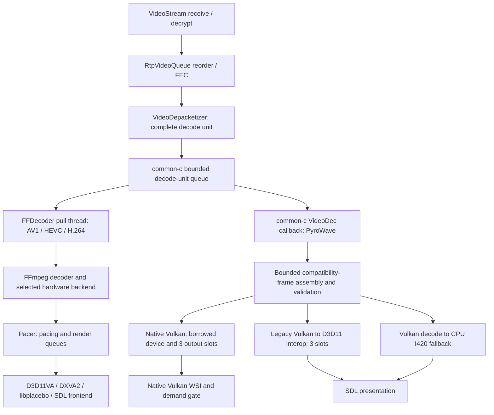

# Phase 2: cross-codec performance audit

Audited starting point: `4944dd5364a8285a03d0da24cf44cf88bb3ac971`
(`main`, including merged PR #50). Primary target: Surface Pro 11,
Snapdragon X Plus / Adreno X1-85, Windows ARM64. Windows x64 remains in scope.

This is a source audit, not a hardware profile. **No runtime optimization is
included in this PR.** The strongest AV1 candidates change driver workarounds,
context ownership or surface accounting and need more focused regression coverage
before implementation. Smaller confirmed CPU costs are ranked below rather than
being presented as a practical Surface performance fix.

Phase 1B remains **paused**. Draft PR #46 and all prior evidence remain untouched.
The ten successful native PyroWave 1440p120 runs establish functional evidence;
their spikes/drops do not establish a cause. No additional benchmark campaign,
JSON manifest, dependency update, merge, tag or release is requested.

## Reading the evidence

Links below refer to the audited source in this repository; function names are
the stable anchors. For pinned common-c, inspect gitlink
`f900dd4767759c7b9d0e93bcea666b55c69ea62f` together with the existing
[P1a patch](../scripts/pyrowave/common-c-p1a.patch). Build-time application of that
patch is already part of the normal build and does not change the pin.

"Confirmed" means the source performs the operation or permits the state.
"Hypothesis" means a performance effect or hardware behavior has not been
measured. Expected Qualcomm defaults below assume ordinary settings and no
environment overrides. The owner's actual selected backend must come from the
normal stream log; device identity alone cannot prove it.

## 1. Shared boundary and complete frame lifecycles

### Network, buffers and decode-unit ownership: all four codecs

`VideoStream.c::VideoReceiveThreadProc()` passes received/decrypted packets to
`RtpvAddPacket()`. `RtpVideoQueue.c` handles ordering/FEC before
`VideoDepacketizer.c::queueRtpPacket()` assembles complete frames. The common-c
decode-unit queue is bounded at 15 entries. Overflow flushes queued work and
requests recovery; its bound is separate from every renderer queue below.
Do not interpret 15 as a normal target queue depth.

H.264/HEVC have NAL/config handling. AV1 and patched PyroWave use the opaque
picture-data branch; RTP fragments are not PyroWave codec packet boundaries.
`LiCompleteVideoFrame()` releases common-c's decode-unit ownership and processes
the decoder result. Neither renderer may keep borrowed fragment pointers after
that completion.

The sharing stops at this boundary. FFmpeg advertises `CAPABILITY_PULL_RENDERER`
and uses its own `FFDecoder` thread. PyroWave has no pull capability and runs on
common-c's dedicated `VideoDec` callback thread through
`Session::drSubmitDecodeUnit()`. Session's decoder mutex protects replacement;
its try-lock can deliberately discard input while a decoder is being recreated.

### AV1, HEVC and H.264: shared FFmpeg route

1. [FFmpegVideoDecoder](../app/streaming/video/ffmpeg.cpp)::`initialize()` tries
   codec hints, hardware candidates and passes, then software if permitted.
   `ffGetFormat()` requires the selected backend's hardware format instead of
   silently accepting software output under a hardware renderer.
2. `completeInitialization()` requests low delay, corrupt/missing-reference output
   and explicit error reporting. Hardware decode uses one FFmpeg decode thread;
   software uses slice threading. It requests `PACER_MAX_OUTSTANDING_FRAMES`
   extra hardware frames. Startup decodes a real embedded format-specific frame
   and tests renderer compatibility; success is not a 1440p120 throughput test.
3. `decoderThreadProc()` waits for a complete DU when caught up. Otherwise it
   receives output, polls for new input on `EAGAIN`, and sleeps 2 ms when neither
   is available. `submitDecodeUnit()` copies fragments into reusable
   `m_DecodeBuffer`, performs the existing H.264 SPS fixup where needed, and calls
   `avcodec_send_packet()`. Its metadata queue copies DU metadata, not ownership
   of the now-invalid fragment pointers.
4. Output receives crop/color/HDR metadata repair where absent, RTP PTS and a
   Pacer-entry timestamp. The AVFrame owns its referenced hardware surface.
   `m_Pacer->submitFrame()` transfers that frame into rendering ownership.
5. [Pacer](../app/streaming/video/ffmpeg-renderers/pacer/pacer.cpp) optionally uses
   `DxVsyncSource`/D3DKMT VBlank on Windows. The pacing queue and render queue
   each have a hard three-frame cap with oldest replacement; historical queue
   occupancy also chooses catch-up drops. Renderer and VBlank threads are
   separate. Queue locks are released before actual rendering.
6. `renderFrame()` retains the last AVFrame in `m_DeferredFreeFrame` until after
   the next render, protecting GPU reads against decoder-pool reuse. Cross-device
   D3D11 rendering additionally waits for the previous consumer fence before
   decoder reuse. Reference retention is not interchangeable with Vulkan's
   explicit per-slot retirement protocol.
7. Idle main-thread notifications dequeue nothing; the dedicated render thread
   waits for nonempty work. There is **no native-PyroWave-style retained-frame
   presentation on every empty SDL wake**. Overlays are updated independently but
   normally composited on the next video frame, rather than causing a new retained
   FFmpeg presentation. Do not add a second demand gate or replace Pacer here.
8. A size change may be handled by the renderer; an adapter/refresh change or
   device reset can recreate it through Session and request IDR recovery.
   `reset()` wakes/joins FFDecoder, destroys Pacer (joining its threads and freeing
   queued/deferred AVFrames), frees the codec, detaches overlays, then deletes
   frontend/backend objects. This ordering preserves frame and device lifetimes.

### Standard-codec GPU renderer branches

**D3D11VA:**
[d3d11va.cpp](../app/streaming/video/ffmpeg-renderers/d3d11va.cpp)::
`initialize()` tries the window's display adapter first, then other adapters.
`checkDecoderSupport()` checks the exact codec profile/output format and hybrid
decode exclusions. It constructs the D3D11 device/context used by FFmpeg rather
than creating an unrelated decoder device behind the renderer.

`createDeviceByAdapterIndex()` chooses either one common decode/render device or
two devices on the same adapter. Two devices require sharing/fences and are
allowlisted by vendor/driver; Qualcomm is excluded by default because the source
records unstable/slow QC710 decoding. It is not evidence that X1-85 has the same
bug, nor evidence that the workaround can be removed safely on X1-85.

For an ordinary Qualcomm adapter, the default is one device and **copy** access.
FFmpeg outputs an NV12/P010 GPU texture-array slice. `renderVideo()` copies that
slice with `CopySubresourceRegion1()` into a reusable shader texture, then draws
the YUV conversion shader into the RGB swapchain. This is a GPU-to-GPU copy,
**not CPU readback**. Bind mode samples precreated SRVs for decoder slices and
avoids that copy; it is used for Intel/separate-device paths or an explicit
override. Whether bind mode improves this Surface safely remains unverified.

One-device rendering locks `m_ContextLock` for clear, draw, overlays, color-space
switch and `Present(0, flags)`; FFmpeg uses the same lock callbacks. That can
serialize CPU submission with decode. With two devices, the renderer instead
uses decode-to-render and render-to-decode GPU fence pairs and brief decode
context locks. These branches solve different driver requirements.

Swapchain buffers, shader resources and decoder-pool SRVs are reused. Vertex/CSC
buffers update on format change (vertex buffer also after resize), not each
ordinary frame. Overlay publication uses a short spinlock, and render-side COM
references retain objects after unlock. A busy overlay update can skip that
overlay for a frame. The five-buffer flip-discard swapchain deliberately avoids
`SetMaximumFrameLatency(1)`; all presentations use sync interval zero. Tearing is
enabled only when requested/supported. Optional Pacer or forced full-screen
pacing supplies VBlank scheduling. Neither this source nor CI proves VRR works
on the Surface in a particular display mode.

**DXVA2:** [dxva2.cpp](../app/streaming/video/ffmpeg-renderers/dxva2.cpp) uses a
D3D9Ex device manager and decoded D3D surfaces. VideoProcessBlt or a quirked
StretchRect converts/scales into the backbuffer; there is no normal CPU video
readback. It has different color/driver restrictions, rejects every 10-bit input
because it cannot signal HDR correctly, and is deferred on ARM64 during its
initial selection pass unless explicitly enabled. It remains a later fallback,
not a forced AV1 replacement. Blocking-present configurations use DONOTWAIT and
1 ms retries to avoid a long D3D device lock. Preserve that API-specific strategy.

**Vulkan/libplacebo:** Windows builds also include
[plvk.cpp](../app/streaming/video/ffmpeg-renderers/plvk.cpp). A Vulkan Video
candidate needs the matching codec extension, queue capabilities, presentation
and (when required) HDR color-space support. Its FFmpeg hardware context shares
the libplacebo Vulkan device and queue lock callbacks. AVFrames are mapped with
`pl_map_avframe_ex()`, rendered, submitted and unmapped; mapping/copy behavior
for a particular format belongs to the pinned library, not to PyroWave's native
presenter. Do not infer absence of library-internal transfers merely from the
mapping call. Windows deliberately swaps buffers in `renderFrame()` because
moving that wait earlier caused recorded Windows/NVIDIA problems.
`cleanupRenderContext()` submits a frame acquired before shutdown so the
swapchain's internal lock is released. The existing AMF AV1/full-range mapping
workaround remains in place.

**Copyback/software:**
[SwFrameMapper](../app/streaming/video/ffmpeg-renderers/swframemapper.cpp) tries
mapping before `av_hwframe_transfer_data()`. An
[SDL frontend](../app/streaming/video/ffmpeg-renderers/sdlvid.cpp) uploads CPU YUV
or converts unsupported formats with swscale before upload. This can add readback,
CPU conversion and upload; it is not the ordinary direct D3D11VA path. Known
hardware backend rejection is not bypassed through the generic backend; the
explicit fallback selection and hardware-only preference still apply.

### PyroWave native Vulkan

1. [PyroWaveVideoDecoder](../app/streaming/video/pyrowave_decoder.cpp)::
   `initialize()` verifies pinned runtime/provenance and attempts native, legacy
   interop, then CPU output **during initialization only**. Native failure
   destroys owner/borrower state before trying the legacy runtime device. Fatal
   live GPU errors require reconnect; they do not hot-switch backends.
2. [assembleLiveDecodeUnit()](../app/streaming/video/pyrowave_transport.h) reuses
   compressed storage with an 8 MiB/4000-fragment bound. The
   [parser](../app/streaming/video/pyrowave_frame.cpp) validates the complete
   compatibility frame, packet bounds, sequence and block data before decode.
   Metadata vectors are reused. Malformed independent frames clear state and
   recover on later frames; removing validation is not a performance option.
3. [NativePresentation](../app/streaming/video/pyrowave_vulkan_live.cpp) owns
   state serialization; Probe owns the Vulkan device/WSI and lends device/queue
   handles to the codec. Compute/fragment preference depends on requirements;
   preferred and actual decoder paths are logged separately. This is Vulkan
   wavelet decode, not the AV1/HEVC/H.264 fixed-function hardware decoder.
4. Decode writes three preallocated slots of GPU R8 Y/Cb/Cr planes directly;
   live output has sampled plus compute-storage or fragment-target usage, without
   video transfer/readback usage. No D3D textures or cross-API memory imports
   exist in this path. Compressed input processing and overlay uploads still use
   CPU memory; "no readback" refers specifically to video output.
5. [LiveSlots](../app/streaming/video/pyrowave_vulkan_live_policy.h) keeps a newest
   pending frame and retained displayed frame. Replaced pending work is explicitly
   retired by [Presenter::retire()](../app/streaming/video/pyrowave_vulkan_presenter.cpp):
   a GPU timeline wait on decode followed by a consumer signal. Submission failure
   preserves pending payload state. Reuse waits on the consumer value; neither a
   CPU slot-state change nor accepted submission proves GPU completion.
6. SDL main-thread presentation is notification-driven. `wakeFrame()` coalesces
   publication/overlay notifications; PR #50's `RenderDemand` gates empty wakes
   while preserving overlay/window damage and unfinished retries. State mutex
   ownership extends through draw/present and can exclude decode publication.
   A distinct nonrecursive queue mutex serializes external queue operations.
7. [Probe::draw()](../app/streaming/video/pyrowave_vulkan_probe.cpp) uses two
   command resources, per-image present semaphores, fence-status checks and a
   finite 1 ms acquire. Not-ready/timeout/rebuild returns to a one-shot 16 ms SDL
   retry, never an immediate repost loop. New video can service retry demand.
   Resize rebuild drains device work; this is exceptional recovery work, not a
   steady-state wait removed by the demand gate. V-sync selects FIFO; otherwise
   preference is Immediate, Relaxed, Mailbox, then FIFO. No independent Pacer or
   guaranteed Surface VRR behavior follows from that choice.
8. [Overlays](../app/streaming/video/pyrowave_vulkan_overlays.cpp) use persistent
   descriptors and three bounded generations per surface. The newest CPU update
   waits if all generations remain in flight; redraws do not re-upload unchanged
   pixels. Retirement uses the actual consumer timeline. Window events mark
   recreation even without new video; minimize/zero drawable retires pending work.
9. Native video is SDR BT.709 8-bit 4:2:0 with validated full/limited range and
   CENTER siting. LEFT is rejected in the native path. PyroWave does not advertise
   HDR; host desktop HDR cannot silently turn it into an HDR pipeline.
10. Shutdown runs on the SDL owner thread after decoder callbacks are excluded.
    It retires pending slots and independently attempts consumer drain even if
    retirement throws, then destroys codec/borrowed wrapper before overlays,
    presenter and Vulkan owner. Partial initialization is cleaned up by the same
    ownership rules. Reconnect constructs a fresh lifetime and timelines.

### PyroWave legacy interop and CPU-output fallback

Legacy [GpuPresentation](../app/streaming/video/pyrowave_gpu.cpp) uses the runtime's
Vulkan device plus SDL's D3D11 device, sharing three R8-plane sets via NT handles.
Each slot imports a shared D3D11 fence as a Vulkan timeline semaphore. Decode
acquires/releases external images; `beginRender()` queues a D3D wait and
`endRender()` queues a reuse signal and flushes submission. Flush is not a CPU
completion wait. Full/limited SDL wrappers are created once per slot.

Its [FrameSlots](../app/streaming/video/pyrowave_queue.h) is a distinct slot model
with one replaceable pending slot, rendering and retained displayed state. It
must not inherit native Vulkan retirement by copying only the CPU state machine.
Main-thread SDL presentation uses SDL V-sync and its own queue/driver behavior.
It has no native `RenderDemand` gate: an empty frame-ready wake with a retained
image reaches clear/copy/overlays/present. Notification coalescing reduces such
wakes but does not make a wake proof of video demand. The incidence on real
streams has not been measured. Window-damage and SDL recovery behavior need
coverage before applying a demand gate.

If interop initialization fails, the established fallback is still Vulkan decode
with synchronous **CPU I420 output**, three freshly sized plane vectors, latest
CPU-frame replacement, and SDL YUV upload. It is not software wavelet decode.
Both fallbacks preserve BT.709 range, remain SDR and use the Session/decoder
error and reconnect boundary. Decoder destruction drains runtime work before
interop handles/SDL textures and device resources are released.

## 2. Comparison matrix

Standard-codec columns describe the ordinary D3D11VA branch; alternate branches
above apply only if selected successfully. Shared code does not prove shared
hardware throughput. "Same" refers to that code path, not codec bitstream cost.

| Concern | AV1 | HEVC | H.264 | PyroWave native | PyroWave fallback |
| --- | --- | --- | --- | --- | --- |
| Hardware decode | FFmpeg AV1 hwaccel, profile 0 NV12/P010 | FFmpeg HEVC Main/Main10 NV12/P010 | FFmpeg AVC profile, NV12 | Vulkan compute/fragment codec | Same Vulkan codec; interop or CPU output |
| GPU-resident video | Yes in direct D3D11 path | Same | Same | Yes, caller-owned R8 planes | Yes interop; no for CPU I420 output |
| Video texture copies | Qualcomm defaults to one GPU slice copy | Same | Same | No live video transfer copy in app | Shared planes in interop; readback/upload in CPU fallback |
| CPU video readback | None in direct path; possible copyback fallback | Same | Same | Forbidden on borrowed native device | None interop; synchronous in CPU output |
| Output publication | Owned AVFrame into Pacer | Same | Same | Timeline payload + pending slot | Slot publication or moved CPU pixels |
| Frame queues | Common-c DU + Pacer queues/metadata | Same | Same | Common-c DU + newest pending of 3 slots | Common-c DU + newest pending slot/pixels |
| Retirement | Deferred AVFrame free; GPU fences if two devices | Same | Same | Explicit dropped-decode GPU consumer signal | Interop fence values/slot reuse; CPU move/free |
| GPU synchronization | Common context ordering/lock or shared fence pairs | Same | Same | Per-slot monotonic timeline + queue mutex | Imported timeline/D3D fence + external ownership |
| Threads/locks | FFDecoder, optional VBlank, render; queue/context/overlay locks | Same | Same | VideoDec + SDL main; state and queue mutexes | VideoDec + SDL main; publication mutex; SDL/D3D operations |
| Scheduling | Optional/forced Pacer, no invented new delays | Same | Same | Arrival/demand + finite WSI retry timer | Arrival/overlay event + SDL present |
| Empty-wake duplicate prevention | Pacer requires queued AVFrame | Same | Same | PR #50 explicit demand gate | Coalesced notifications, no retained draw gate |
| Overlay updates | COM objects published under spinlock; next video draw | Same | Same | Changed/deferred generations can redraw retained video | SDL texture update can redraw retained image |
| Present timing | DXGI sync 0, optional tearing; Pacer/DWM sequencing | Same | Same | FIFO or available non-vsync policy; bounded acquire | SDL V-sync policy; interop signal after present |
| Error recovery | IDR requests, repeated decode failure/device-reset recreation | Same | SPS fixup also retained | Independent-frame rejection; fatal GPU error reconnect | Init-only fallback; live fatal errors stop stream |
| Resize/reconnect | D3D resize or Session recreation; fresh decoder/Pacer | Same | Same | Rebuild demand, drain and recreate; fresh lifetime on reconnect | SDL size handling or Session recreation |
| HDR/color | Main8 SDR; Main10 SDR/HDR, NV12/P010 shader + RGB PQ/sRGB switch | Main/Main10 SDR/HDR similarly | NV12 SDR in normal supported profile | SDR BT.709 range-aware shader, CENTER | SDR BT.709 range-aware SDL; no HDR |
| Shutdown | Join decode/Pacer, free frames/codec, then renderers | Same | Same | Retire/drain, borrower then owner | Drain decoder then interop/SDL/runtime |

## 3. AV1 on Surface ARM64: findings and uncertainties

**Selection is capability-driven.** Ordinary Windows pass zero prefers D3D11VA
over DXVA2, while Vulkan Video is another pass-zero candidate when exposed by
FFmpeg and supported by the driver. It is not safe to claim AV1 always uses
D3D11VA. D3D11 rejection can come from disabled environment setting, unavailable
device/interfaces, exact profile/format support, hybrid restrictions, failed
texture/fence/swapchain initialization or the embedded test frame. A first-pass
full-screen SDR/V-sync-off case without tearing can intentionally defer D3D11
to DXVA2. `NoHardwareSupport` can prune later hardware attempts for that decoder;
4:4:4 is excluded from that terminal conclusion because Vulkan may support more.
Hardware-only preference disallows the final software fallback.

**No hidden CPU readback in the ordinary D3D11 route was found.** On Qualcomm,
one-device/copy is the code default, so surfaces stay GPU-resident through a GPU
copy and conversion. It costs memory bandwidth but is an intentional compatibility
choice, not a proven redundant copy. `D3D11VA_FORCE_BIND` and
`D3D11VA_FORCE_SEPARATE_DEVICES` are existing diagnostic overrides, not new defaults
or owner smoke-test requirements. Neither override is requested by this audit.

**At 120 FPS** one nominal frame period is 8.33 ms. The FFmpeg 2 ms empty-input
poll, Pacer's integer-millisecond VBlank/slack calculation, potential DXGI blocking
under the common context lock and surface pressure are plausible latency/jitter
contributors. Their presence in code does not prove they caused a visible stall.
Changing a sleep, queue depth, max latency or lock scope could merely move a wait
or break lifetime protection. No such tuning is included.

**Main8 versus Main10:** D3D11 checks AV1 profile 0 with NV12 versus P010,
respectively; the swapchain is RGBA8 versus RGB10A2. Color/range/chroma metadata
drives CSC; PQ frames switch DXGI color space to Rec.2020 PQ, other frames restore
sRGB signaling. FFmpeg attaches missing mastering/content-light metadata and
preserves bitstream metadata precedence. Main10 can also be SDR. DXVA2's 10-bit
rejection must not turn into a silent HDR downgrade. Vulkan/libplacebo has its
own HDR capabilities and color-mapping policy. No Surface HDR output, panel/host
support or driver behavior is established by this audit.

**Workarounds preserved:** `isSeparateTestDecoderRequired()` rebuilds the `av1`
decoder after the 720p embedded probe before using the stream extent, because
the recorded FFmpeg AV1 hwaccel path cannot safely reuse that context after a
size change. The hardware pix_fmt-hint exclusion, cropping of small excess encoder
padding and libplacebo's AMF AV1 color workaround also remain. No upstream fix or
compatibility result was established that justifies removing any of them.

## 4. Cross-pipeline learning, in both directions

| Direction | Demonstrable advantage / reusable principle | Limit on transfer |
| --- | --- | --- |
| Standard codecs to PyroWave | FFmpeg/Pacer already avoids rendering with no queued output; renderer readiness is considered before latching output in supported backends | Keep native overlay/window redraws and retry demand; Pacer is not a drop-in replacement for latest-slot publication |
| D3D11VA to PyroWave | Reused textures/SRVs and GPU synchronization avoid CPU video output; native PyroWave already achieves this without cross-API imports | Shared D3D11 handles/fences would add work to native, not remove it |
| Standard codecs to PyroWave | Conditional format-dependent vertex/CSC rebuilding and libplacebo texture reuse are useful patterns for fallback overlay/resource churn | Dynamic text dimensions and asynchronous consumers require correct retirement; do not update an in-use image |
| PyroWave to standard codecs | Native slots and persistent descriptors make ownership/in-flight states explicit; use that discipline to audit Pacer surface accounting | AVFrame references and delayed consumer fences are different guarantees; do not replace them with CPU slot flags |
| PyroWave to standard codecs | Bounded counters identify decode submission, publication, WSI calls, retirement and backend selection separately | Existing FFmpeg decode/render averages do not provide the same segmentation; targeted low-overhead counters may help if a specific stall needs diagnosis |
| PyroWave to standard codecs | Coalesced notifications and render-demand checks eliminate actual redundant native WSI work | Direct D3D11VA already requires new queued video, so there is no demonstrated duplicate-present fix to port there |
| Native PyroWave to legacy PyroWave | No-video/no-overlay/no-window/no-retry demand can skip GPU presentation entirely | Cover legacy window damage, SDL recovery, disabled overlays and displayed-slot fence behavior first |

Native PyroWave performs fewer cross-API imports than its legacy interop branch,
and fewer video readback/upload operations than CPU output. D3D11 bind mode
performs fewer explicit video copies than copy mode. These are operation-count
advantages, not proof that Vulkan beats D3D11 or that bind beats copy on X1-85.

## 5. Ranked opportunities and implementation decision

Priority balances evidence, potential practical AV1 benefit, affected paths,
risk, compatibility and testability. No row asserts a measured FPS/latency gain.

| Rank / opportunity | Evidence and classification | Expected benefit; coverage; AV1 Surface relevance |
| --- | --- | --- |
| 1. Prove aggregate Pacer surface accounting before tuning it | **Confirmed accounting concern:** each queue has a cap of 3; `pacer.h` declares only `3 + rendering + deferred = 5` outstanding frames. With a blocked renderer, the code permits both queues to hold frames; the source-level maximum is 6 queued + 1 rendering + 1 deferred. **Hypothesis:** a real selected decoder pool exhausts or stalls because of it | Potential decode/render overlap and fewer pool-starvation stalls; all 3 standard codecs; high AV1 relevance when pacing is active. This is not a proposed queue-depth increase/decrease |
| 2. Audit Qualcomm copy/context submission cost | **Confirmed:** copy mode and one-device render lock through Present. **Hypothesis:** this dominates X1-85 frame time; QC710 workaround may/may not still be needed | Potential reduction in a GPU copy or decode/render exclusion; AV1/HEVC/H.264; highest potential Surface benefit, but substantial driver risk |
| 3. Extend demand semantics to legacy PyroWave | **Confirmed:** retained-frame empty wakes can clear/copy/present; native avoids them. **Hypothesis:** enough duplicate wakes occur to matter | Avoid GPU/present/fence work and CPU cost on interop/CPU fallback; both PyroWave fallbacks; no direct AV1 benefit |
| 4. Remove per-frame libplacebo overlay scratch allocations | **Confirmed:** two local vectors reserve `OverlayMax` on every mapped render, even with no enabled overlays | Small CPU allocator saving for all 3 standard codecs when libplacebo is selected; no default D3D11 Surface benefit; do not call this an AV1 throughput fix |
| 5. Reuse fallback overlay textures/geometry where dimensions match | **Confirmed:** D3D11 overlay updates create new texture/SRV/vertex objects; legacy SDL recreates changed overlay textures. Native has generation reuse | Less allocation/upload overhead when overlays change; 3 standard codecs plus legacy PyroWave with separate API-specific implementations; conditional, usually low-rate Surface benefit |
| 6. Investigate retry/readiness scheduling with existing deadlines intact | **Confirmed:** native 16 ms retry exceeds 8.33 ms; standard empty receive poll is 2 ms. **Hypothesis:** either produces the observed spikes | Potential recovery/pickup latency benefit; separately affects native PyroWave and standard codecs; not a shared magic timer value |
| 7. Reduce lock-held release work / add narrowly scoped stall diagnostics | **Confirmed:** Pacer `dropFrameForEnqueue()` frees under queue lock (other drop loops unlock); native holds state mutex through WSI. **Hypothesis:** actual lock contention is material | Potential shorter producer exclusion; standard codecs and native PyroWave, through different implementations; Surface effect unknown |

| Rank | Implementation risk and compatibility | Focused test needed before a runtime patch |
| --- | --- | --- |
| 1 | Medium/high if the remedy changes drop policy or pool size; hardware pool/DPB requirements vary. Preserve both queue caps and intended historical catch-up behavior | Actual Pacer + reference-counted fake surfaces, stalled renderer/VBlank/producer interleavings, active/disabled pacing, pool bound, reset and shutdown. Establish accounting independently of timing/performance |
| 2 | High: vendor workaround, format-specific bind support, driver serialization and GPU resource lifetime | Exact selected Surface backend from ordinary log; mock ownership/failure tests; one-device/cross-device tests for NV12/P010, resize/device loss. Do not force a backend or request an override campaign now |
| 3 | Medium: an empty wake may represent window damage; interop displayed slot/fence must remain valid | No work on stale wake, overlay-only disable/change, resize/expose/minimize/restore, new video replacing retained retry, failed event push, reconnect and teardown |
| 4 | Low for fixed scratch storage, but cleanup list must allow both replaced and subsequently disabled textures for each overlay in one iteration | Actual overlay batch replacement/disable in one frame (up to twice OverlayMax retirements), render-submit failure cleanup, no allocation after entry, unchanged lifetime through render/unmap |
| 5 | Medium: COM/SDL upload concurrency and GPU-in-flight reuse differ | Repeated same-size/different-size text, failed allocation, enable/disable during draw, resize, deferred generation completion and teardown |
| 6 | Medium/high: lower delay may increase CPU wakes; callbacks/coalescing and WSI acquire/fence bounds must remain correct | Deadline-driven deterministic scheduler tests and bounded wake counts; no speculative interval change or assumed performance gain |
| 7 | Medium/high for lock restructuring: might extend surface retention or move waits. Lower for diagnostic counters if specifically justified | Delayed destructors, concurrent enqueue/render/shutdown, lock ordering and resource limits; bounded/disabled diagnostic overhead and correctly labeled CPU versus GPU timing |

**Decision:** retain runtime behavior in this audit PR. Rank 1 deserves a
dedicated production-Pacer regression harness before choosing a remedy; rank 2
cannot be decided from another Qualcomm generation's workaround comment. Rank 3
needs legacy damage/recovery tests. Rank 4 is a valid small follow-up but affects
an alternate renderer and requires lifetime coverage; it does not justify
presenting this phase as a demonstrated AV1 Surface improvement. Ranks 5-7 also
need their stated evidence/coverage. No wait, pool depth, frame-drop policy, GPU
barrier, timeline value, quality, HDR capability or dependency pin is changed.

## 6. Validation boundaries

See [the PR validation record](PERFORMANCE_CROSS_CODEC_VALIDATION.md) for exact
commands, commit identity, CI run/job results, skips and the candidate ARM64
artifact. Only completed checks in that record are claimed as verified.

Existing suites exercise malformed/fragmented frames, range handling,
negotiation, slot replacement, demand gating, retirement failure, timeline
overflow, queue locking, deferred overlay generations and cleanup. They do not
exercise real Surface AV1 Main8/Main10, HEVC Main/Main10, H.264 or 1440p120
throughput. Full Windows x64/ARM64 builds verify compilation/package integration;
GPU-free mocks and GPU-unavailable skips do not qualify hardware performance.
There is no new runtime change requiring new implementation-specific tests.

## 7. Owner smoke guide, once a candidate ARM64 build is available

Use the PR's ordinary unsigned ARM64 portable artifact, extracted into a new
folder. Keep the old package and original evidence. Use normal settings and
logging; profiling remains optional/off. No toolkit, manifest or repeated runs.

1. Play AV1 at 1440p120 for a few minutes. Check smoothness, artifacts, audio and
   input; retain the normal log so the selected decoder/renderer is visible.
2. Resize, toggle the statistics overlay and minimize/restore; disconnect normally.
   Reconnect once if checking that a new session starts cleanly.
3. If host/display/settings already support it, briefly check AV1 Main10 HDR,
   including correct colors/brightness and normal disconnect. Mark unavailable
   HDR as untested, not failed.
4. Briefly play HEVC and H.264; check HEVC Main10/HDR only if already available.
5. Briefly play ordinary PyroWave and check overlay, resize and disconnect. Keep
   native versus fallback backend labels distinct. Do not force legacy/CPU
   fallback or a backend override solely for this documentation-only PR.

A functional smoke result is useful, not a statistical performance qualification.
No additional manual behavior is required by this PR. Owner review is the next
decision; stop at the draft PR and results, without merging or releasing.
